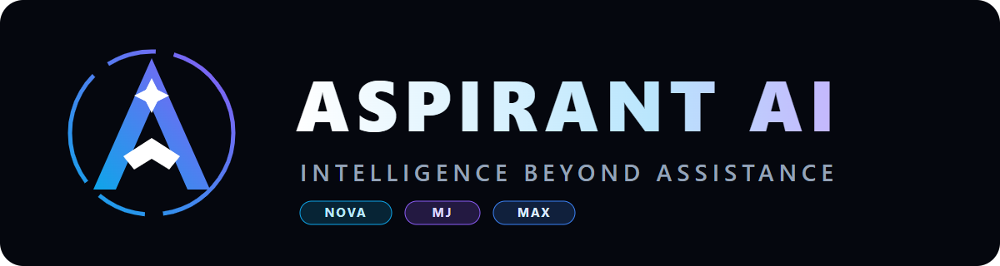

<p align="center">
  
</p>

# Aspirant AI Ecosystem

**Tagline:** *Intelligence Beyond Assistance*

**Aspirant AI** is a modular, security-hardened, cross-device AI operating ecosystem uniting a native Windows desktop assistant, a human-like deep intelligence engine, a web control center, and an Android-first mobile companion.

## Core Products

1. **NOVA (`apps/nova`, `src/aspirant`, `desktop/`)** — Advanced Desktop AI Assistant for Windows
   - Wake-word activation (`"Hey Nova"` / `"Hey Aspirant"`), female neural TTS & 18+ Indian languages (`src/aspirant/voice`, `src/aspirant/personality`)
   - Clipboard intelligence, WinRT OCR / screen vision, isolated Microsoft Edge automation, file manager, command policy guardrails, coding studio, media studio, and 19 verified `.gov.in` portal workflows
   - Electron + Tauri compatibility shell with system tray, notification center, global hotkeys (`Ctrl+Shift+N`, `Ctrl+Shift+M`), and background backend supervisor
2. **MJ (`apps/mj`)** — Human-Like Intelligent Companion
   - Cross-device persistent memory, context awareness, adaptive user profiling
   - Document understanding & grounded RAG indexing (`Qdrant` + `Chroma`)
   - Email drafting, calendar conflict analysis, deep research mode, and milestone planning
3. **MAX (`apps/max`, `mobile/`)** — Android-First Mobile AI Companion
   - Flutter Material 3 Android app with offline SQLite (`sqflite`) persistence and Android Keystore JWT token storage
   - Voice commands, AI chat, smart reminders, daily planner, habit streaks, AI-summarized notes, push notifications (`Celery`), and delta sync

## Repository Architecture

```text
AspirantAI/
├── apps/
│   ├── nova/           # NOVA desktop service & FastAPI endpoints
│   ├── mj/             # MJ intelligence service & FastAPI endpoints
│   └── max/            # MAX mobile companion service & delta sync endpoints
├── backend/
│   ├── app/
│   │   ├── core/       # Config, Async SQLAlchemy 2.0, Argon2/JWT/Refresh, Fernet encryption, DI container
│   │   ├── domain/     # Entities & repository protocols
│   │   ├── infrastructure/ # ORM models, concrete repositories, Redis cache adapter
│   │   ├── ai/         # Multi-model router (Gemini/GPT/Ollama), ToolRegistry, RAG, Qdrant + Chroma vector stores
│   │   ├── memory/     # Short-term, long-term, preference, conversation recall & semantic search
│   │   ├── agents/     # 7 collaborating agents (Research, Automation, Coding, Content, Productivity, Planning, Support)
│   │   ├── services/   # Auth, Audit, Productivity services
│   │   ├── workers/    # Celery worker + background tasks
│   │   └── api/v1/     # REST API v1 routers
│   ├── migrations/     # Alembic schema migrations
│   └── tests/          # Ecosystem backend integration tests
├── frontend/           # Next.js + TypeScript + TailwindCSS + Framer Motion control center
├── desktop/            # Electron tray/hotkey app + Tauri Rust compatibility shell
├── mobile/             # Flutter Android-first MAX mobile app
├── src/aspirant/       # Native Windows PySide6 13-view workstation & core engines
├── infrastructure/     # Dockerfiles, Docker Compose, Azure Bicep, VPS systemd/Nginx, Cloudflare Workers/Tunnel
├── docs/               # Brand guidelines, social media kit, architecture, API, deployment & user manuals
└── scripts/            # Asset generators, DB migration helpers, dev launchers, and verification script
```

## Quick Start

- **Installation & Local Run:** See [docs/INSTALLATION.md](docs/INSTALLATION.md)
- **User Manual:** See [docs/USER_MANUAL.md](docs/USER_MANUAL.md)
- **API Reference:** See [docs/API_DOCUMENTATION.md](docs/API_DOCUMENTATION.md)
- **Architecture Deep Dive:** See [docs/ARCHITECTURE.md](docs/ARCHITECTURE.md)
- **Deployment Guide:** See [docs/DEPLOYMENT.md](docs/DEPLOYMENT.md)
- **Development Guide:** See [docs/DEVELOPMENT.md](docs/DEVELOPMENT.md)
- **Brand Identity:** See [docs/brand/brand-guidelines.md](docs/brand/brand-guidelines.md)
